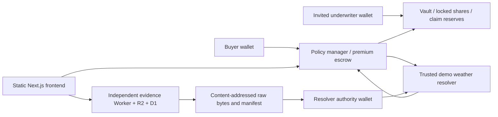

# AEGIS — Underwrite uncertainty.

A category-neutral onchain risk marketplace combining parametric protection and collateralized underwriting. The educational Monad Testnet prototype currently implements Pune rainfall cover; Travel, Agriculture, Logistics, and Events are clearly labeled upcoming categories. Buyers accept manager-set quotes; invited underwriters reserve the entire maximum claim. A designated authority commits weather evidence, anyone can finalize that commitment, and contracts settle payouts or refunds.

**Mock funds have no monetary value. There is no real-world coverage, guaranteed return, licensed offering, independent audit, or decentralized weather truth guarantee.**

## Current engineering status

Contracts, six wallet-connected screens, independent evidence service, immutable ERA5 specifications, competing vaults, and reproducible local demo are implemented. The local demo executed 55 real Monad-configured Anvil transactions, including YES/NO/INVALID settlement, redemption, and purchase from Wallet C's competing vault. Browser tests executed another purchase-to-settlement flow through the UI. Typecheck, lint, production build, contract scenario/fuzz/invariant tests, and evidence tests have been executed; see `docs/PROGRESS.md` for the latest exact results.

**The final contracts are deployed and source-verified on Monad Testnet.** Creation inputs, runtime bytecode, role bindings, and the 1,000/200 exposure ceilings were checked against RPC. The final deployment charged 0.695341258006750886 test MON; actual receipts are in `deployments/monad-testnet.json`. The earlier deployment is preserved in history. Public frontend and independent archive publication records are in `deployments/hosting.json`. The MVP remains incomplete until real A/B/C wallet purchases, settlements, redemption, and competing quotes are verified.

## WYRD deployed contract addresses

Network: **Monad Testnet** · Chain ID: **10143**. Use the **Policy Manager** address when a submission asks for the project's main contract.

| Contract | Deployed address / explorer |
| --- | --- |
| Policy Manager — main contract | [`0xf72da3dbf0c764e5d962847efce7223877259226`](https://testnet.monadscan.com/address/0xf72da3dbf0c764e5d962847efce7223877259226) |
| Weather Resolver | [`0x16e8e989931be076c11d821908dc6737c237f4db`](https://testnet.monadscan.com/address/0x16e8e989931be076c11d821908dc6737c237f4db) |
| Mock USDC | [`0xc574794b36fedf6dd2f0e621cc2240d96664a1e6`](https://testnet.monadscan.com/address/0xc574794b36fedf6dd2f0e621cc2240d96664a1e6) |
| Demo vault #1 | [`0x494caA956dD5D13B9Dc04607c04Da927F6f5A1ff`](https://testnet.monadscan.com/address/0x494caA956dD5D13B9Dc04607c04Da927F6f5A1ff) |

These contracts use test MON and valueless mock USDC. Deployment receipts and verification records are retained in [deployments/](deployments/).

## Why underwriting differs from speculation

The underwriter commits capital to fund a buyer's conditional payout and receives the contractual premium only after settlement. Shares cannot be transferred, deposits stop when underwriting begins, and capital cannot exit while liabilities remain. The prototype does not offer tradable prediction positions or leverage. Underwriters need compensation for expected claims, correlated weather losses, capital lockup, operating costs, and their opportunity cost. A manually quoted premium does not demonstrate profitable or actuarially sound underwriting.

## Architecture



Solidity 0.8.28, OpenZeppelin 5.6.1, Foundry 1.8.0 with Monad execution, Next.js 16.4, TypeScript, Tailwind, shadcn-style Radix button primitives, wagmi 3, and viem 2. Evidence uses a separately deployed Cloudflare Worker, R2 objects, and D1 capture catalog. Local evidence storage uses SQLite and files with the same interface.

## Setup and checks

Use Node.js 22.14+ and the workspace-local Foundry binaries under `.tools/foundry`. Their official 1.8.0 download was checked against the release SHA-256. Install that release on a fresh machine; do not use a legacy Monad Foundry fork. Run from this project directory:

```powershell
npm ci
.\.tools\foundry\forge.exe install --root contracts --no-git foundry-rs/forge-std@v1.11.0
npm run contracts:test
npm run abi
npm test
npm run typecheck
npm run lint
npm run build
```

The lockfile pins dependencies. MONSKILLS was installed in the parent workspace `.agents/skills`; start with its `monskill` routing skill. The user's external-wallet and encrypted-keystore decisions supersede its Para/Alchemy defaults.

## Reproduce the local demonstration

In three terminals, from this directory:

```powershell
# Terminal 1
.\.tools\foundry\anvil.exe --network monad --chain-id 31337 --host 127.0.0.1 --port 8545
# Terminal 2 (run after Anvil is ready)
npm run abi
npm run demo
npm run dev --workspace evidence
# Terminal 3
npm run dev
```

Open `http://127.0.0.1:3000/operator/` and import `deployments/local.json`. This verifies code and manager/token/resolver bindings against RPC. It is explicitly labeled LOCAL. Anvil's conventional development accounts A/B/C are used only by loopback-guarded local scripts and browser tests. Never fund or use those accounts on another network. The seed script preserves previous deployments and liabilities; reruns deploy fresh contracts rather than erase history.

```powershell
node scripts/browser-qa.mjs
```

This uses a fresh headless Chrome session and a local-only EIP-1193 test adapter. Its transactions execute on Anvil; no mocked token balances or confirmation messages are returned. Public builds contain neither that adapter nor signing keys.

## Monad deployment and real demo

See `docs/DEPLOYMENT.md` and `docs/DEMO_SCRIPT.md`. Import Wallet A into an encrypted Foundry keystore yourself and keep the key/password out of chat, source, and logs. Run `scripts/deploy-testnet.ps1`, record receipts, verify deployed sources through the MONSKILLS verification API, then configure the evidence service's verified manager allowlist. Seed and fund vaults using the authorized A/C wallets and buy policies with B. Until these actions are executed, the app shows its pending deployment state and disables financial transactions.

Primary deployment metadata, actual faucet hashes, and verification records live in `deployments/`. Local transaction records are in `.local/demo-results.json`. No fake explorer links or predicted simulation addresses are published as deployed contracts.

## Product and trust limits

The governing value is Open-Meteo's `models=era5` daily `rain_sum` for the committed grid and IST calendar day. It is gridded reanalysis, not a venue station reading. The first validated snapshot archived from day 5 to before day 14 is frozen. Preliminary ERA5T is accepted; later corrections do not change settlement. Onchain commitment must occur before the 14-day deadline. After a valid commitment, INVALID is permanently disabled and finalization remains possible after the deadline. Without that commitment, permissionless timeout INVALID refunds premiums.

The trusted authority can post false values or withhold commitment; the trusted capture service can be unavailable or misbehave. Content hashes make changes inspectable but do not prove weather truth or guarantee storage availability. Infrastructure administrators can affect archive availability even though the application exposes no overwrite/delete API. Parametric basis risk means an event organizer may suffer losses without the trigger, or receive a payout without equivalent losses.

UMA is not integrated: its published network list did not contain Monad during research. Adapter-based future integration needs verified deployment addresses, incentives, dispute design, and bridge/trust analysis. No pricing probability is fabricated. Forecast ensemble estimates, generalized products, AI underwriting, indexers, tranches, yield strategies, and mainnet deployment are outside v1.

## Licenses and attribution

AEGIS code is MIT licensed. OpenZeppelin, wagmi, viem, Next.js, Tailwind, Radix, and lucide licenses remain with their packages. Weather attribution and API-use restrictions are documented in `docs/ATTRIBUTION.md`. The free Open-Meteo API is used only for this educational non-commercial prototype; commercial or promotional use requires appropriate provider permission or subscription.

## Frontend design and validation

The category-neutral homepage, category previews, filtered discovery, market detail, protection, underwriting, portfolio tabs, resolution, operator, and documentation use one shared visual system. See `docs/FRONTEND_DESIGN.md`.

Run `node scripts/design-qa.mjs` for category behavior and layout checks at 1440/1024/768/390 pixels. For wallet QA against the existing loopback-only Anvil deployment, first run `node scripts/prepare-browser-qa.mjs`, then `node scripts/browser-qa.mjs`. The preparation script registers fresh synthetic fixtures while preserving prior liabilities. Browser QA checks real local transactions, wrong-network and rejection states, approvals, deposits, quotes, settlement, capital locks, and redemption. Never use its conventional test accounts on a remote network.

## Pune and Mumbai weather integration

Read [WEATHER_DATA.md](docs/WEATHER_DATA.md) for immutable v3 location configurations, real historical replay discovery, forecast references, oracle CLI operations, trust assumptions and licensing. Run `npm run weather:discover`, `npm run oracle:prepare`, and `npm run demo:historical`. Earlier issued v1/v2 terms and deployed interfaces are preserved. Public testnet registration/resolution uses the authorized wallet.
