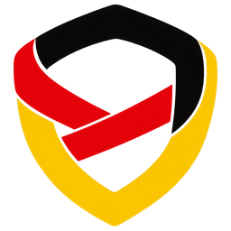
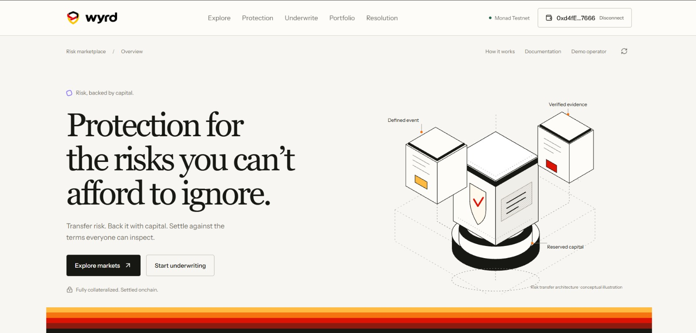
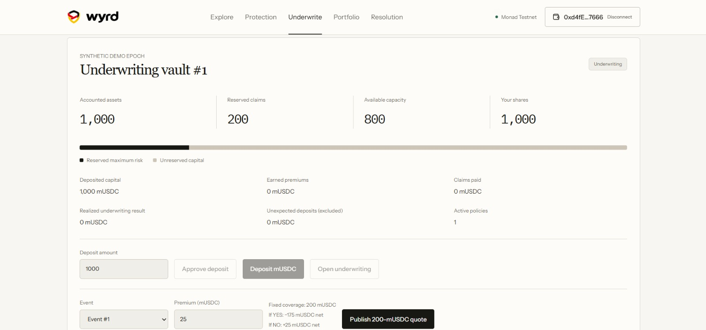
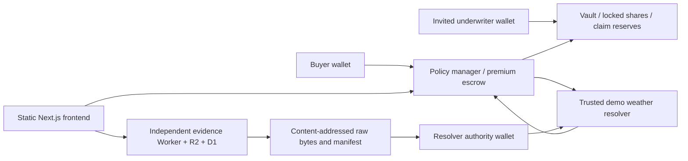

<div align="center">



<picture>
  <source media="(prefers-color-scheme: dark)" srcset="docs/images/wyrd-wordmark-dark.png" />
  
</picture>

### Underwrite uncertainty.

An onchain risk marketplace on Monad: buy parametric protection against real-world events, or back it with fully collateralized capital.

[**Live app**](https://wyrd-rosy.vercel.app/) · [**Project post on X**](https://x.com/Adity0ux/status/2108896685493825935) · [Docs](docs/) · [Contracts on Monad Testnet](#deployed-contracts-monad-testnet)

<<<<<<< HEAD
## WYRD deployed contract addresses

Network: **Monad Testnet** · Chain ID: **10143**. Use the **Policy Manager** address when a submission asks for the project's main contract.

| Contract | Deployed address / explorer |
| --- | --- |
| Policy Manager — main contract | [`0xf72da3dbf0c764e5d962847efce7223877259226`](https://testnet.monadscan.com/address/0xf72da3dbf0c764e5d962847efce7223877259226) |
| Weather Resolver | [`0x16e8e989931be076c11d821908dc6737c237f4db`](https://testnet.monadscan.com/address/0x16e8e989931be076c11d821908dc6737c237f4db) |
| Mock USDC | [`0xc574794b36fedf6dd2f0e621cc2240d96664a1e6`](https://testnet.monadscan.com/address/0xc574794b36fedf6dd2f0e621cc2240d96664a1e6) |
| Demo vault #1 | [`0x494caA956dD5D13B9Dc04607c04Da927F6f5A1ff`](https://testnet.monadscan.com/address/0x494caA956dD5D13B9Dc04607c04Da927F6f5A1ff) |

These contracts use test MON and valueless mock USDC. Deployment receipts and verification records are retained in [deployments/](deployments/).

## Why underwriting differs from speculation
=======
   
>>>>>>> d358febc97dc9e11f2a776f4cfc949e105810abd

</div>

> [!WARNING]
> Wyrd is an educational testnet prototype. Mock funds have no monetary value. There is no real-world coverage, guaranteed return, licensed offering, independent audit, or decentralized guarantee that the weather data is true.



## What is Wyrd?

Some risks are easy to describe and hard to insure. "More than X mm of rain falls on the day of my event" is one of them. Wyrd turns a risk like that into a contract with fixed terms:

- **Buyers** pay a premium for a fixed payout that triggers automatically if the defined event happens.
- **Underwriters** deposit capital into a vault that reserves the full maximum claim for every policy it backs, and earn the premium when the policy settles.
- **Settlement** happens onchain against weather evidence that anyone can inspect and verify by hash.

The first live category is **rainfall cover for Pune and Mumbai**, settled on ERA5 reanalysis data. Travel, Agriculture, Logistics, and Events are shown in the app as upcoming categories.

### Why it is underwriting, not betting

Underwriters commit capital to fund someone else's conditional payout, and they only receive the premium after settlement. Vault shares cannot be transferred, deposits close once underwriting begins, and capital cannot leave while liabilities remain. There are no tradable prediction positions and no leverage. A premium set by hand does not show that the underwriting is profitable or actuarially sound; see [ECONOMICS.md](docs/ECONOMICS.md).

## How it works

1. **Define the event.** A dated weather specification fixes the location grid cell, the IST calendar day, the rainfall threshold, and how the governing data snapshot is chosen. Once registered, it cannot be changed.
2. **Fund a vault.** Invited underwriters deposit mock USDC during the funding phase, then open the vault for underwriting.
3. **Quote and buy.** The vault publishes a quote (for example, 200 mUSDC of cover for a 25 mUSDC premium). Buying it locks the full 200 mUSDC claim in the vault and holds the premium in a separate escrow.
4. **Commit evidence.** The evidence service archives the raw Open-Meteo ERA5 response with content hashes. A designated resolver authority commits the result onchain before the 14-day deadline.
5. **Settle.** Anyone can finalize a valid commitment. On **YES**, the reserved claim is paid to the buyer. On **NO**, the reserve is released back to the vault. In both cases the vault earns the premium. On **INVALID** (no valid commitment by the deadline), the buyer's premium is refunded.
6. **Redeem.** After issuance ends and every policy has settled, the epoch closes and underwriters redeem their shares.



## Architecture



| Layer | Stack |
|---|---|
| Contracts | Solidity 0.8.28, OpenZeppelin 5.6.1, Foundry 1.8 with Monad execution |
| Frontend | Next.js 16 (static export), React 19, TypeScript, Tailwind 4, wagmi 3, viem 2 |
| Evidence service | Cloudflare Worker, R2 object storage, D1 capture catalog (SQLite and local files when run locally) |
| Weather data | Open-Meteo `models=era5` daily `rain_sum` |

More detail: [ARCHITECTURE.md](docs/ARCHITECTURE.md), [PRODUCT_SPEC.md](docs/PRODUCT_SPEC.md), [EVENT_SPECIFICATION.md](docs/EVENT_SPECIFICATION.md).

## Deployed contracts (Monad Testnet)

The final contracts are deployed on Monad Testnet (chain ID 10143) and source-verified. Creation inputs, runtime bytecode, role bindings, and the 1,000 / 200 mUSDC exposure ceilings were checked against RPC.

| Contract | Address |
|---|---|
| `AegisPolicyManager` | [`0xf72da3dbf0c764e5d962847efce7223877259226`](https://testnet.monadscan.com/address/0xf72da3dbf0c764e5d962847efce7223877259226) |
| `DemoWeatherResolver` | [`0x16e8e989931be076c11d821908dc6737c237f4db`](https://testnet.monadscan.com/address/0x16e8e989931be076c11d821908dc6737c237f4db) |
| `MockUSDC` | [`0xc574794b36fedf6dd2f0e621cc2240d96664a1e6`](https://testnet.monadscan.com/address/0xc574794b36fedf6dd2f0e621cc2240d96664a1e6) |

Underwriting vaults are created by the policy manager. The contracts were deployed before the rename and keep their original `Aegis` names. Deployment receipts are in [`deployments/monad-testnet.json`](deployments/monad-testnet.json) and verification results in [`deployments/verification-results.json`](deployments/verification-results.json).

## Run it locally

**Requirements:** Node.js 22.14 or newer, and [Foundry](https://getfoundry.sh) 1.8 or newer (the official release, not a legacy Monad fork).

```powershell
git clone https://github.com/aditya-17-eth/Wyrd.git
cd Wyrd
npm ci

# The forge wrapper looks for .tools/foundry/forge(.exe).
# Copy your Foundry binaries there, or set FORGE_BIN to your forge path.

# Install forge-std (run from inside contracts/)
cd contracts
forge install --no-git foundry-rs/forge-std@v1.11.0
cd ..
```

### Checks

```powershell
npm run contracts:test   # lifecycle, fuzz, and invariant tests
npm run abi              # export ABIs to the web app and evidence service
npm test                 # evidence, generator, and RPC tests
npm run typecheck
npm run lint
npm run build
```

### Local demo on a Monad-configured Anvil chain

Run each in its own terminal, from the repo root:

```powershell
# 1. Local chain
.\.tools\foundry\anvil.exe --network monad --chain-id 31337 --host 127.0.0.1 --port 8545

# 2. Once Anvil is ready: deploy, seed the demo, start the evidence service
npm run abi
npm run demo
npm run dev --workspace evidence

# 3. Frontend
npm run dev
```

Open <http://127.0.0.1:3000/operator/> and import `deployments/local.json`. The app checks the code and contract bindings against RPC and labels everything **LOCAL**. The demo uses Anvil's well-known development accounts through loopback-only scripts. Never fund or use those accounts on another network.

Browser QA against the local chain:

```powershell
node scripts/prepare-browser-qa.mjs
node scripts/browser-qa.mjs   # real local transactions through the UI
node scripts/design-qa.mjs    # layout checks at 1440 / 1024 / 768 / 390 px
```

### Weather tooling

```powershell
npm run weather:discover     # real historical replay discovery
npm run oracle:prepare
npm run demo:historical
```

See [WEATHER_DATA.md](docs/WEATHER_DATA.md) for location configs, forecast references, oracle CLI operations, and licensing.

### Deploying to Monad Testnet

See [DEPLOYMENT.md](docs/DEPLOYMENT.md) and [DEMO_SCRIPT.md](docs/DEMO_SCRIPT.md). Import the deployer wallet into an encrypted Foundry keystore yourself, and keep keys and passwords out of chat, source, and logs. Copy `.env.example` to `.env` for local configuration; the browser only reads public deployment JSON, never secrets.

## Trust model and limits

- **Governing data.** Settlement uses Open-Meteo's ERA5 daily `rain_sum` for the committed grid cell and IST day. This is gridded reanalysis, not a reading from a station at your venue.
- **Snapshot rule.** The first validated snapshot archived between day 5 and day 14 is frozen. Preliminary ERA5T is accepted, and later corrections do not change settlement.
- **Deadline.** A commitment must land onchain before the 14-day deadline. After a valid commitment, INVALID is permanently disabled and anyone can finalize, even after the deadline. Without one, anyone can trigger a timeout INVALID that refunds the premium.
- **Trusted parties.** The resolver authority could post a false value or withhold a commitment, and the capture service could be unavailable or misbehave. Content hashes make tampering detectable; they do not prove the weather was real or guarantee storage availability.
- **Basis risk.** An event organizer may suffer losses without the trigger firing, or receive a payout without equivalent losses.
- **Not integrated:** UMA (not listed on Monad during research). Also out of scope for v1: forecast-based pricing, AI underwriting, indexers, tranches, yield strategies, and mainnet.

Full analysis: [ORACLE_TRUST_MODEL.md](docs/ORACLE_TRUST_MODEL.md), [THREAT_MODEL.md](docs/THREAT_MODEL.md), [OBJECTIONS_AND_RESPONSES.md](docs/OBJECTIONS_AND_RESPONSES.md).

## Project status

| Area | Status |
|---|---|
| Contracts | Deployed and source-verified on Monad Testnet |
| Tests | Contract lifecycle, fuzz, and invariant suites; evidence and RPC tests |
| Frontend | Live at [wyrd-rosy.vercel.app](https://wyrd-rosy.vercel.app/), with explore, protection, underwriting, portfolio, resolution, operator, and docs pages |
| Evidence archive | Published as an independent service |
| Testnet demo | Vault #1 funded; full buyer, settlement, redemption, and competing-vault flow with real wallets still in progress |

Exact, dated results are recorded in [PROGRESS.md](docs/PROGRESS.md).

## Documentation

| Document | Covers |
|---|---|
| [PRODUCT_SPEC.md](docs/PRODUCT_SPEC.md) | Product scope and user flows |
| [ARCHITECTURE.md](docs/ARCHITECTURE.md) | System design |
| [EVENT_SPECIFICATION.md](docs/EVENT_SPECIFICATION.md) | How weather events are specified |
| [ECONOMICS.md](docs/ECONOMICS.md) | Underwriting economics |
| [ORACLE_TRUST_MODEL.md](docs/ORACLE_TRUST_MODEL.md) | Resolver trust assumptions |
| [THREAT_MODEL.md](docs/THREAT_MODEL.md) | Threats and mitigations |
| [WEATHER_DATA.md](docs/WEATHER_DATA.md), [ERA5_INTEGRATION.md](docs/ERA5_INTEGRATION.md) | Weather data pipeline |
| [DEPLOYMENT.md](docs/DEPLOYMENT.md), [DEMO_SCRIPT.md](docs/DEMO_SCRIPT.md) | Deploying and demoing |
| [FRONTEND_DESIGN.md](docs/FRONTEND_DESIGN.md), [FRONTEND_VALIDATION.md](docs/FRONTEND_VALIDATION.md) | UI design system and QA |
| [VALIDATION_PLAN.md](docs/VALIDATION_PLAN.md), [PROGRESS.md](docs/PROGRESS.md) | Validation plan and results |

## License and attribution

Wyrd's code is [MIT licensed](LICENSE). OpenZeppelin, wagmi, viem, Next.js, Tailwind, Radix, and lucide keep their own licenses. Weather attribution and API-use restrictions are in [ATTRIBUTION.md](docs/ATTRIBUTION.md). The free Open-Meteo API is used only for this non-commercial educational prototype; commercial use needs the provider's permission or a subscription.

<div align="center">

Built on [Monad](https://monad.xyz) · [Live app](https://wyrd-rosy.vercel.app/) · [Wyrd on X](https://x.com/Adity0ux/status/2108896685493825935)

</div>
